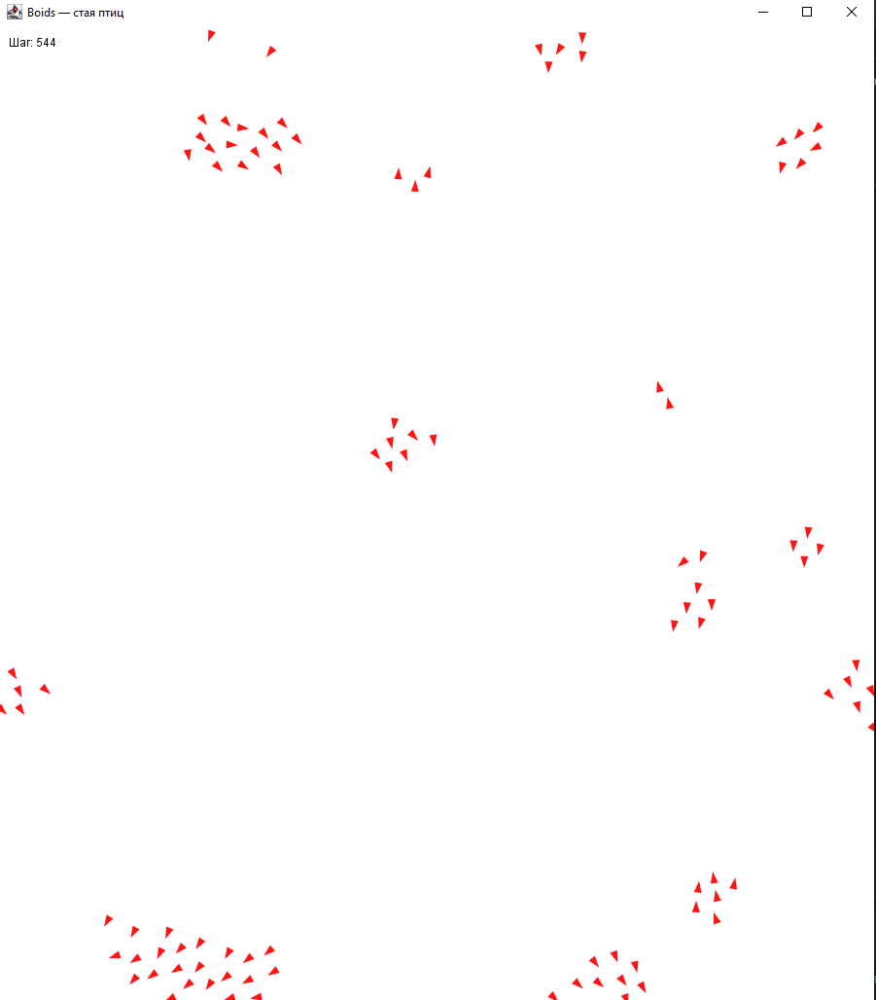

# Лабораторная работа №3 — Искусственный Интеллект

**Вариант №1 — Моделирование движения стаи птиц в 2D (алгоритм Boids)**

## Описание

Симуляция коллективного поведения стаи птиц (Boids) на основе алгоритма Крейга Рейнольдса (1986).  
Каждый Boid движется автономно, руководствуясь тремя локальными правилами без централизованного управления.

### Реализованные правила Boids

| Правило | Описание |
|---|---|
| **Центрирование (Cohesion)** | Каждая птица стремится к центру масс соседей в радиусе восприятия |
| **Выравнивание (Alignment)** | Каждая птица согласует направление и скорость движения с соседями |
| **Разделение (Separation)** | Каждая птица избегает столкновений, отдаляясь от слишком близких соседей |

## Запуск

Требования: **Java 21**, **Maven 3.x**

```bash
cd Lab3_AI
mvn compile exec:java -Dexec.mainClass="com.study.Panel.BoidsPanel"
```

Или запустить главный класс напрямую из IDE: `com.study.Panel.BoidsPanel`

## Скриншот


